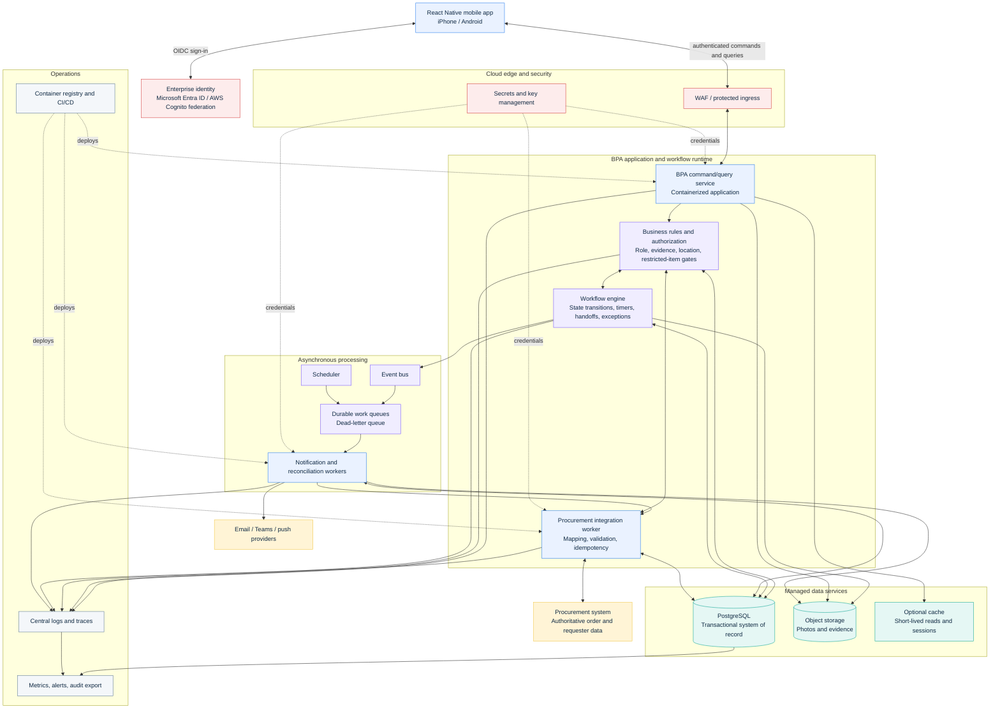

# PackageFlow Cloud System Architecture

This is a deployable cloud architecture for the PackageFlow backend. It uses concrete cloud services, while keeping the design portable between AWS and Azure. The diagram does not introduce a standalone API layer; the mobile command/query surface is deployed as part of the BPA application runtime.

## Deployable architecture

## Service deployment mapping

| Logical service | AWS deployment | Azure deployment | Design note |
|---|---|---|---|
| Mobile command/query runtime | Amazon ECS on Fargate behind an Application Load Balancer; EC2 capacity is an alternative when host control is required | Azure Container Apps; AKS is the alternative when Kubernetes control is required | This is the BPA-owned application surface used by the mobile app. It is not modeled as a separate API product. |
| BPA business rules | Container in ECS/Fargate or Lambda for small event handlers | Container App or Azure Functions | Keep authorization and business validation close to workflow transitions. |
| Workflow engine | AWS Step Functions for durable orchestration; ECS/Lambda workers for task execution | Azure Logic Apps Standard, Power Automate for approved business workflows, or Durable Functions for code-heavy orchestration | Select one primary workflow engine. Do not duplicate state ownership across engines. |
| Procurement integration worker | ECS/Fargate worker or Lambda; EventBridge and SQS for retries | Container Apps Job or Azure Functions; Service Bus and Logic Apps for integration workflows | Uses idempotency keys, source-version checks, retries, and a dead-letter path. |
| Event bus | Amazon EventBridge | Azure Event Grid | Publishes domain events such as PackageReceived, AssignmentAccepted, EvidenceUploaded, and DeliveryCompleted. |
| Durable work queue | Amazon SQS with dead-letter queues | Azure Service Bus queues with dead-letter queues | Used for reconciliation, upload, and retry work. |
| Scheduler | EventBridge Scheduler | Logic Apps recurrence, Azure Functions Timer Trigger, or Container Apps Jobs | Drives reminders, assignment timeouts, procurement sync, and metric aggregation. |
| Transactional database | Amazon RDS for PostgreSQL or Aurora PostgreSQL | Azure Database for PostgreSQL Flexible Server | Private network placement, backups, encryption, point-in-time restore, and high availability. |
| Evidence object storage | Amazon S3 with private buckets, lifecycle rules, versioning, and KMS encryption | Azure Blob Storage with private containers, lifecycle management, and customer-managed keys where required | Store binary evidence here; store metadata and references in PostgreSQL. |
| **Optional cache** | Amazon ElastiCache for Redis | Azure Cache for Redis | Optional only; never make the cache the source of truth for package state. |
| Identity | Microsoft Entra federation into Amazon Cognito, or an enterprise OIDC provider | Microsoft Entra ID | Use enterprise identity and role/group claims. Do not duplicate the employee directory in PackageFlow. |
| Secrets and keys | AWS Secrets Manager and AWS KMS | Azure Key Vault and managed identities | No secrets in mobile code, container images, source control, or workflow definitions. |
| Notifications | Amazon SES for email, Amazon SNS or mobile push provider for push, Teams connector/webhook where approved | Microsoft Graph/Teams connectors, Azure Communication Services, and mobile push provider | Notification intent and delivery outcome are persisted in the database. |
| Monitoring and tracing | Amazon CloudWatch, X-Ray/OpenTelemetry, CloudTrail | Azure Monitor, Application Insights/OpenTelemetry, Log Analytics, and Activity Logs | Correlate mobile action, workflow run, job, notification, and database transaction with a correlation ID. |
| Container registry and delivery | Amazon ECR with CodePipeline/CodeBuild or GitHub Actions | Azure Container Registry with Azure DevOps/GitHub Actions | Promote the same image through dev, QA, pilot, and production. |
| Edge protection | AWS WAF, ALB, optionally CloudFront | Azure Front Door or Application Gateway WAF | Use only if the mobile ingress requires public edge exposure; keep database and queues private. |

AWS Fargate runs ECS containers without requiring management of the underlying servers, while Azure Container Apps provides serverless container hosting, autoscaling, internal ingress, and scheduled or event-driven jobs. Amazon RDS for PostgreSQL and Azure Database for PostgreSQL Flexible Server are the proposed managed relational options. Amazon S3 and Azure Blob Storage are the proposed object-storage options. See the official service documentation linked below.

## Recommended production topology

### AWS option

- Private VPC subnets for ECS/Fargate services, RDS PostgreSQL, ElastiCache, and SQS/EventBridge integrations.
- Public ingress limited to WAF and an Application Load Balancer.
- S3 private bucket for evidence with lifecycle and retention rules.
- Step Functions as the authoritative workflow state machine.
- EventBridge for domain events and Scheduler for timed work.
- SQS queues for durable asynchronous work and dead-letter handling.

### Azure option

- Virtual Network integration for Container Apps, PostgreSQL Flexible Server, Service Bus, and private storage endpoints.
- Front Door or Application Gateway WAF for protected ingress.
- Blob Storage private containers for evidence.
- Logic Apps Standard or Durable Functions as the authoritative workflow state machine, with Power Automate reserved for approved human/business-process integrations.
- Event Grid for events, Service Bus for durable work queues, and Logic Apps/Functions/Container Apps Jobs for scheduled work.

## Design decisions

### 1. BPA owns orchestration

The BPA layer owns business rules, integrations, workflow execution, retries, and scheduled operations. The mobile app is a client of these capabilities. A separate API product is intentionally not introduced as a top-level architectural component.

### 2. PostgreSQL is the transactional source for PackageFlow

PackageFlow needs relational integrity across packages, package counts, assignments, custody events, status history, acknowledgements, exceptions, notifications, evidence metadata, and audit events. PostgreSQL is preferred over a document store for these cross-entity invariants.

### 3. Object storage holds evidence, not the database

Photos and other binary evidence belong in S3 or Blob Storage. PostgreSQL stores the evidence type, package link, uploader, timestamp, checksum, upload state, storage key, and retention class.

### 4. Events are at least once and handlers are idempotent

Event buses and queues are used for decoupling and resilience. Consumers must tolerate duplicate delivery. Every command and background job should carry an idempotency key and correlation ID.

### 5. No distributed transaction with procurement

The procurement system is an external source of truth. PackageFlow should not attempt a two-phase commit across procurement, BPA, database, storage, and notification providers. Use an outbox/inbox pattern, source versions, retries, and compensating actions.

### 6. One authoritative workflow state owner

The workflow engine is the only component allowed to advance package lifecycle state. The mobile app, notification worker, and integration worker submit commands or events; they do not independently mutate lifecycle state.

### 7. Single-region write authority with asynchronous disaster recovery

The initial design uses one primary region for transactional writes, with multi-zone high availability and asynchronous cross-region backups or replicas. Active-active multi-region writes are not justified until pilot volume, recovery objectives, and data residency requirements require them.

## CAP theorem and consistency decisions

CAP is applied per subsystem, not as one label for the entire application. During a network partition, a distributed subsystem must trade consistency or availability; the right choice differs for package state, evidence, notifications, and offline mobile work.

| Subsystem | Choice | CAP interpretation | Operational consequence |
|---|---|---|---|
| Package lifecycle database | Consistency + partition tolerance (CP) | Do not accept conflicting lifecycle writes during a database partition. | A user may see a temporary error or read-only state instead of creating an unsafe duplicate handoff or delivery. |
| Assignment and custody | CP | Custody must have one authoritative ordering of events. | Reject or queue conflicting reassignment/acceptance commands and reconcile using the workflow owner. |
| Mobile offline queue | Availability-first locally, eventual consistency globally | The device can capture permitted work offline, but the server remains authoritative after synchronization. | Use idempotency keys, optimistic UI labels such as Pending Sync, conflict rules, and a visible sync failure state. |
| Evidence upload | Local availability with eventual server consistency | Capture may complete locally before cloud upload completes. | Keep upload status Pending/Uploaded/Failed and do not mark Delivered until the evidence gate passes or an approved exception is recorded. |
| Notifications | Availability and eventual consistency | Notification delivery must not block the core transaction indefinitely. | Persist intent, retry asynchronously, expose failure, and allow resend without creating a second lifecycle event. |
| Domain events and queues | Availability and partition tolerance with at-least-once delivery | Processing continues when consumers are briefly unavailable. | Consumers are idempotent; duplicates are expected and harmless. |
| Cross-region disaster recovery | Eventual consistency | Replicas/backups may lag the primary region. | Define an RPO and accept that the most recent unreplicated changes may need reconstruction during regional recovery. |

### Practical CAP position

PackageFlow should favor CP behavior for the small set of operations that change custody, lifecycle state, or restricted-item status. It should favor availability and eventual consistency for notifications, analytics, retry queues, and offline capture. This prevents unsafe package-state conflicts while keeping the mobile workflow usable during temporary downstream outages.

## Main failure and recovery paths

| Failure | Expected behavior |
|---|---|
| Procurement unavailable | Permit only previously synchronized/read-safe actions; queue retryable lookup/sync work; do not fabricate authoritative order data. |
| Database unavailable | Fail closed for lifecycle-changing actions; preserve a user-friendly retry state; mobile may retain permitted offline evidence/actions. |
| Evidence upload fails | Keep evidence Pending or Failed, retry, and prevent Delivered until policy allows an exception. |
| Notification provider fails | Keep notification intent persisted, retry with backoff, surface the failure to Facilities Lead, and avoid duplicate lifecycle transitions. |
| Workflow worker fails | Durable queue or workflow runtime retries; dead-letter after threshold; alert operations with correlation ID. |
| Mobile loses connectivity | Store permitted offline work encrypted on device, show Pending Sync, and reconcile using idempotency keys. |
| Regional outage | Promote the approved recovery environment or restore from backup according to RTO/RPO; reconcile external procurement and notification state afterward. |

## Sources

- [AWS Fargate for Amazon ECS](https://docs.aws.amazon.com/AmazonECS/latest/developerguide/AWS_Fargate.html)
- [Amazon RDS for PostgreSQL](https://docs.aws.amazon.com/AmazonRDS/latest/UserGuide/CHAP_PostgreSQL.html)
- [Amazon S3](https://docs.aws.amazon.com/AmazonS3/latest/userguide/Welcome.html)
- [Amazon EventBridge](https://docs.aws.amazon.com/eventbridge/latest/userguide/eb-what-is.html)
- [Azure Container Apps](https://learn.microsoft.com/en-us/azure/container-apps/overview)
- [Azure Database for PostgreSQL Flexible Server](https://learn.microsoft.com/en-us/azure/postgresql/configure-maintain/quickstart-create-server)
- [Azure Blob Storage](https://learn.microsoft.com/en-us/azure/storage/blobs)
- [Azure Service Bus](https://learn.microsoft.com/en-us/azure/service-bus-messaging/)
- [Azure Monitor Application Insights and OpenTelemetry](https://learn.microsoft.com/en-us/azure/azure-monitor/app/app-insights-overview)
